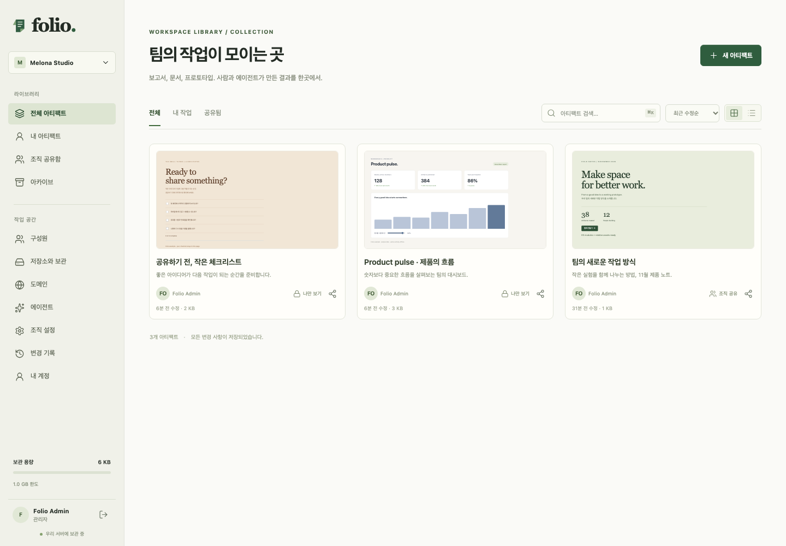

# Folio

**An artifact library for your team and its agents, on your own infrastructure.**

Publish static HTML sites with an `index.html` entry point and related assets: interactive reports, prototypes and presentations. Keep them private, share with your organization or selected people, or make a public link. Folio runs on your machine or internal network; its core needs no cloud account, email service, model subscription or Internet connection. Version0.1 requires `index.html`; standalone PDF/image-only publication is not supported.



First-party code is [MIT licensed](LICENSE). [Installation and operations](INSTALL.md) · [HTTP API](docs/API.md) · [DNS guide](docs/dns.md)

## Install with one prompt

Paste this into your coding agent:

```text
Install Folio from https://github.com/YangTaeyoung/folio. Read INSTALL.md and
scripts/install.sh first, download the latest release for this machine, and
verify its SHA-256 against the release checksums before installing in my user
bin directory. Start `folio serve` with a new private persistent data directory
and localhost-only management/content listeners. Show me the private first-run
setup URL so I can create the admin account. Install the portable Folio skill
for this agent without overwriting existing files. Explain how I can create a
scoped API token and configure `folio mcp`; keep tokens out of logs and shell
arguments. Leave public ingress and DNS disabled until I request them.
```

Or download and inspect the installer yourself:

```sh
curl -fsSL https://raw.githubusercontent.com/YangTaeyoung/folio/main/scripts/install.sh -o /tmp/folio-install.sh
less /tmp/folio-install.sh
sh /tmp/folio-install.sh
folio serve --data-dir ./folio-data
```

The first-run URL appears in the terminal. Open it and create your organization and administrator. There is no default password or open registration. The admin creates other accounts in **Members**.

## A place for the work your agents make

- **Personal and team libraries:** search your artifacts, organization shares and items shared with you; switch between grid/list views.
- **Share from a side panel:** private, organization, selected people or public; optional expiry and immediate revocation. Recipients have read access; owners and admins manage content.
- **Interactive artifacts:** isolated execution hostnames, relative assets and JavaScript modules, retained revisions, rollback and ZIP downloads.
- **Storage and lifecycle:** local filesystem, AWS S3, R2/MinIO and other S3-compatible services, Google Cloud Storage and Azure Blob. Configure/test a backend and select it for new revisions while keeping old revisions accessible.
- **Retention you control:** quota, upload limit and retention period; reject uploads or explicitly opt into deleting the oldest eligible content. Archive protects artifacts from automatic deletion and still counts toward quota.
- **Domains:** manual DNS records for any provider, Cloudflare token provisioning and official browser login via optional `cloudflared`. A dedicated Cloudflare Tunnel can provide public ingress. Domain Connect is available only for configured, provider-approved templates. See [DNS](docs/dns.md).
- **Backoffice:** admin-created accounts, roles, temporary password reset, suspension, organization settings and audit history.
- **Agent tools included:** CLI, official Go SDK MCP stdio server and a portable skill; use your preferred model and gateway.

On-prem **public** means anyone who can reach your Folio server. Internet sharing requires deliberate ingress configuration. Administrators can manage all artifacts in the installation.

## Publish from an agent or terminal

Create a token under **Agents & API keys**, with the scopes you need. Paste it privately into stdin, then signal EOF (Ctrl-D on Unix):

```sh
folio login --url http://folio.localhost:4310 --token-stdin
folio doctor
folio publish --title "Quarterly report" ./report
folio list --view mine
folio share --visibility organization ARTIFACT_ID
```

Flags precede positional arguments. Publication defaults to private. For a revision, inspect the artifact and pass its current version ID:

```sh
folio inspect ARTIFACT_ID
folio publish --artifact ARTIFACT_ID --base-version VERSION_ID ./report
folio archive ARTIFACT_ID
folio restore ARTIFACT_ID
folio skills install --client codex
```

The skill installer also accepts `--client claude`, `--client agents` or an explicit `--dir`. Existing skill files are preserved. Download releases include the skill inside the executable; no extra runtime is needed.

## Connect MCP

Configure a local stdio MCP server in your client's supported settings:

```json
{
  "mcpServers": {
    "folio": {
      "command": "/absolute/path/to/folio",
      "args": ["mcp"],
      "env": { "FOLIO_URL": "http://folio.localhost:4310" }
    }
  }
}
```

Use the private `folio login` config, or set `FOLIO_TOKEN` in your client's secret environment settings. Do not commit tokens. MCP tools discover capabilities, find/inspect artifacts, list recipients, publish/update local files, replace sharing, archive/restore, roll back a revision and launch an authorized preview. The `folio://guide` resource and `publish_artifact` prompt describe the workflow. Token scopes and current member permissions apply to every operation.

## Build and run

Requires Go **1.26+**, Node **24+** and npm for building; release binaries need neither Node nor Go at runtime.

```sh
make build
./dist/folio serve --data-dir ./folio-data
# Or build and start the container:
docker compose up --build -d
docker compose logs folio
```

Both listeners default to loopback. Configure LAN DNS/origins and TLS before exposing them; see [INSTALL.md](INSTALL.md). Docker's core image intentionally does not bundle `cloudflared`; use token/manual DNS and your own reverse proxy, or install a compatible `cloudflared` in a derived image for browser login/tunnel management.

```sh
go test ./...
go test -race ./...
cd web && npm ci && npm run typecheck && npm run build
```

[Verification evidence](docs/verification/2026-11-14.md) records local, container and live HTTPS checks. [Try the included examples](examples/README.md).

Storage adapters have HTTP-contract/emulator tests; these do not claim your cloud account has been connected. Live deployment evidence belongs in `docs/verification/`.

## Security and backups

Serve the management UI and each artifact on separate origins. Keep `data.key`, database, objects and provider credentials private. Stop Folio and back up the complete data directory together; external object stores need their own matching backup. [Operations and restore instructions](INSTALL.md#backup-and-restore) explain the boundary.

Folio runs uploaded content in a sandbox on per-artifact hostnames. Uploaded content is untrusted. Do not grant it management-origin execution or weaken the documented origin separation.
